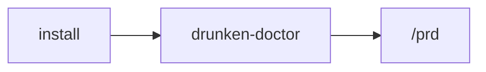

# Getting Started

From a clone or installation to using the SDLC skills in a project.



## Install

Needs [`uv`](https://docs.astral.sh/uv/) and Git.

```bash
uv tool install git+https://github.com/sornbuen15/drunken-guild@v2.0.3   # pick the tag you want
drunken-install all                                                      # skills + agents -> ~/.claude
drunken-install extras --apply                                          # optional: the older skills and agents
drunken-install hook --apply                                            # both hooks: session context + per-prompt routing
drunken-doctor                                                          # proves it: credential, skills/agents, both hooks
```

`drunken-install all --dry-run` shows what it would write first. The skills and agents travel
inside the package, so one install gives you both.

## Update

```bash
uv tool install --force git+https://github.com/sornbuen15/drunken-guild@<new-tag>
drunken-install status      # what would change, and the changelog entry; writes nothing
drunken-install all         # apply it
```

A tag is a pin — nothing here relies on `uv tool upgrade` moving it.

> **On Windows, close every Claude window first.** `uv tool install --force` fails with "Access
> is denied" while the running MCP server still holds the tool's files open. If that happened,
> delete `%APPDATA%\uv\tools\drunken-guild` and install again without `--force`.

## Jira integration (optional)

When Jira is registered, its issues can supply tasks and audit evidence. The core skills also
work from user requests and project files without Jira. Setup details — credentials,
`drunken-init`, and proving the credential resolves — are in
[`Drunken-Guild-Guide.md`, section 2](./Drunken-Guild-Guide.md#2-registry-credentials-and-the-mcp-server).

## Use from a clone

Read the repository's `AGENTS.md`, then open the relevant `skills/flow/*/SKILL.md` and follow it.
For an agent that supports skills, use its documented discovery mechanism; otherwise point the
agent at the skill file explicitly. No runtime or Jira registration is required for the core flow.

## An existing project

1. Install the shared skills into the selected project or user-level location using the installer.
   Inspect its dry run first; it must preserve existing instruction and command files.
2. Read the project's existing `AGENTS.md`; if none exists, add a concise instruction file that
   points to relevant skills and project rules without overwriting existing guidance.
3. Run `/prd`, then `/clarify`, then `/ddd` when the task benefits from the full flow. Each prints
   which project documents it found and where — the map is the project's root `AGENTS.md`. When there is no map, the defaults are
   `.ai/PRD.md`, `.ai/DOMAIN.md`, `.ai/audit/`, `docs/`, `docs/decisions/`.
4. `/breakdown` proposes project tasks from requirements and domain context. It uses Jira only if
   Jira is registered and selected; otherwise tasks can remain in project files or the conversation.
   For Jira, the hierarchy is `REQ-xxx -> Epic -> Story | Task -> Subtask` (Story and Task are Epic
   children); without Jira, use the project's own task hierarchy.
5. `/build` implements one approved task, validates acceptance, and follows the repository's own
   review policy. Small work can start directly at `/build`.
6. `/audit` traces requirements to implementation and observed verification; it reports unknowns
   where sources such as a tracker or deployment are unavailable.

If deployment applies to a project, the deployment target is recorded in its own `AGENTS.md`;
`/audit` treats that target as a claim to verify, not as proof that deployment occurred.

A project that keeps its documents somewhere else works too — record the paths in `AGENTS.md` and the skills follow; only two copies of the same document is a stop. An older project's
`PROJECT_BRIEF.md` or `REQUIREMENTS.md` stays where it is — `/prd` offers to consolidate it into
one `PRD.md`, naming what the sources disagreed about, never silently. A Jira backlog someone
else already cut is read first, not duplicated: `/breakdown` binds an existing ticket instead of
creating a second one for the same work.

> **New or existing, an untracked AI layer has no worktree memory.** `AGENTS.md`, `CLAUDE.md` and
> `.claude/` are deliberately not committed, so a *new* `git worktree` of either kind of project
> starts with none of them — details: [`docs/REFERENCE.md`](./docs/REFERENCE.md#ai-layer-location-and-git-worktrees).

## Agent compatibility

Compatibility and discovery status are recorded per agent in
[`docs/AGENT-COMPATIBILITY.md`](./docs/AGENT-COMPATIBILITY.md). Do not infer auto-discovery from
the fact that an agent can read Markdown files.

## Windows notes

- PowerShell 5.1+ or [PowerShell 7+](https://github.com/PowerShell/PowerShell/releases).
- Close every Claude window before `uv tool install --force` (see Update, above).

## Doctor

```bash
drunken-doctor
```

Checks three things: the Jira credential actually authenticates (not that the Jira project
itself exists — a bad credential can come back `200` with an empty list; confirm the key
yourself the first time); that this machine's installed skills and agents match the package; and
that both hooks actually run rather than merely sitting unused in `~/.claude/settings.json`.
`drunken-install hook --apply` installs both of them: the SessionStart context and the
per-prompt route.

## Where to go next

| | |
|---|---|
| [`README.md`](./README.md) | the two-sentence version and the flow table |
| [`docs/REFERENCE.md`](./docs/REFERENCE.md) | the extras catalog, the flow in detail, mid-sprint scenarios, known limitations |
| [`AGENTS.md`](./AGENTS.md) | the rules, if you are contributing here |
| [`skills/INDEX.md`](./skills/INDEX.md) | every skill, its trigger and its path |
| [`Drunken-Guild-Guide.md`](./Drunken-Guild-Guide.md) | architecture, Jira workflow, approvals |
| [`Integration-Guide.md`](./Integration-Guide.md) | bringing another project under this workflow |
