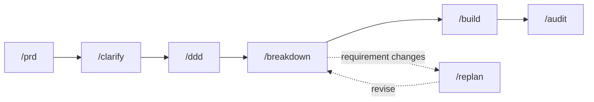

# Drunken Guild

**A skills-first, evidence-driven SDLC workflow for one person working with AI coding agents.**

Most AI engineering projects start by adding more agents. Drunken Guild started there too, then
kept changing whenever the evidence showed that another role, service, or control surface added
more coordination than value. The current release packages the resulting workflow, safety floor,
portable skills, and optional integrations. Jira is optional.

## Why it evolved

| stage | what changed | what the project learned |
|---|---|---|
| Automation first | Many specialist agents, scripts, a local board, and remote approval machinery | More surfaces created drift and made the real state harder to identify. |
| Skills first | Three roles and seven workflow steps replaced overlapping agents and commands | Methods should be reusable; roles should own responsibility, not duplicate instructions. |
| Monitoring experiment | A local Hub was built to observe and control agent work, then retired | Provider-limited metadata could not prove machine-wide agent, session, subagent, task, and ticket visibility. |
| Next direction | A lightweight, evidence-driven, human-governed AI engineering workflow | Use the process appropriate to the risk, preserve human authorization, and change the plan when requirements change. |

The retired work is not hidden: [`RETIRED.md`](./RETIRED.md) records what left, why, what replaced
it, and the commit that can recover it. Planned behavior remains distinct from shipped behavior in
[the PRD](./.ai/PRD.md).

## The shipped flow



| stage | step |
|---|---|
| requirement | `/prd` |
| clarify | `/clarify` |
| spec | `/ddd` |
| plan and tasks | `/breakdown` |
| implement | `/build` |
| validate | `/audit` |
| replan | `/replan` |

Replan preserves valid work when requirements change instead of restarting the project.

## Install

```bash
uv tool install git+https://github.com/sornbuen15/drunken-guild@v2.1.0
drunken-install all
drunken-doctor
```

Optional extras and safety hooks are applied explicitly. Follow [`GETTING_STARTED.md`](./GETTING_STARTED.md)
for the verified install, update, first-project, and Windows paths.

## What is real today

- Portable `SKILL.md` workflows, with manager, worker, and reviewer roles.
- A deny floor, approval boundaries, repository guards, and evidence-based checks.
- Optional Jira MCP, usage estimates, registry, and isolated worktree utilities.
- Agent compatibility claimed only for the versions and scenarios recorded in
  [`docs/AGENT-COMPATIBILITY.md`](./docs/AGENT-COMPATIBILITY.md).
- No Hub, live-session dashboard, autonomous merge, or autonomous deployment.

## Read next

[`GETTING_STARTED.md`](./GETTING_STARTED.md) - install and first use ·
[`docs/REFERENCE.md`](./docs/REFERENCE.md) - capabilities and limits ·
[`DESIGN.md`](./DESIGN.md) - decisions and evidence ·
[`AGENTS.md`](./AGENTS.md) - contributor rules; a project's root `AGENTS.md` is the map ·
[`CONTRIBUTING.md`](./CONTRIBUTING.md) - development workflow

Licensed under [MIT](./LICENSE). Security policy: [`SECURITY.md`](./SECURITY.md).
