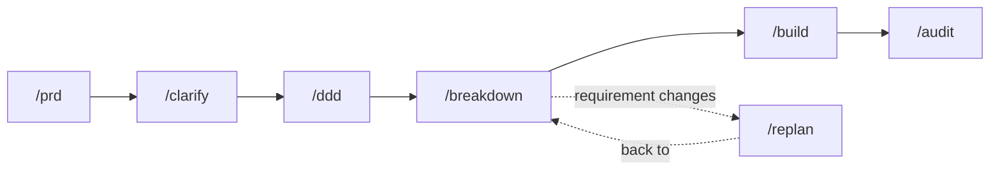

# Drunken Guild

Drunken Guild gives AI coding agents one standard way to take a requirement through Jira to a
merged pull request. It is for a developer or small team who directs AI agents on real projects
and wants the same skills, roles and review gates every time.

## The flow — seven commands



| stage | step |
|---|---|
| requirement | `/prd` |
| clarify | `/clarify` |
| spec | `/ddd` |
| plan and tasks | `/breakdown` |
| implement | `/build` |
| validate | `/audit` |
| replan | `/replan` |

## Install

```bash
uv tool install git+https://github.com/sornbuen15/drunken-guild@v2.0.3   # pick the tag you want
drunken-install all                                                      # skills + agents -> ~/.claude
drunken-install extras --apply                                          # optional: the older skills and agents
drunken-install hook --apply                                            # both hooks: session context + per-prompt routing
drunken-doctor                                                          # proves it: credential, skills/agents, both hooks
```

Full steps, update, Windows notes: [`GETTING_STARTED.md`](./GETTING_STARTED.md).

**Limits.** It installs from a git tag, not from PyPI — nothing has been released there yet. The
full list of known limitations is in [`docs/REFERENCE.md`](./docs/REFERENCE.md).

## Where to go next

| | |
|---|---|
| [`GETTING_STARTED.md`](./GETTING_STARTED.md) | install, update, your first project, Windows notes |
| [`docs/REFERENCE.md`](./docs/REFERENCE.md) | skills vs agents, the extras catalog, the flow in detail, known limitations |
| [`AGENTS.md`](./AGENTS.md) | the rules, if you are contributing here — a project's root `AGENTS.md` is the map to its own documents |
| [`skills/INDEX.md`](./skills/INDEX.md) | every skill, its trigger and its path |
| [`REPOSITORY_MAP.md`](./REPOSITORY_MAP.md) | which directory is whose, and the `templates/` inventory |
| [`Drunken-Guild-Guide.md`](./Drunken-Guild-Guide.md) | architecture, Jira workflow, approval flow |
| [`DESIGN.md`](./DESIGN.md) | why it is shaped this way |
| [`CONTRIBUTING.md`](./CONTRIBUTING.md) | pull requests land on `develop`; `main` only from `develop` |

Licensed under [MIT](./LICENSE). Security policy: [`SECURITY.md`](./SECURITY.md).
