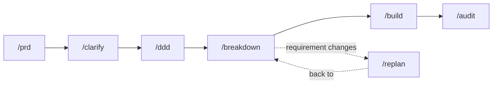

# Drunken Guild

One repository holding the standard AI coding agents follow: skills and roles that run a
spec-driven flow end to end, and MCP servers that let them coordinate real work through Jira. A
project's root `AGENTS.md` is the map to its own documents; this repository's own rules are its
own `AGENTS.md`.

## The flow — seven commands



| stage | step |
|---|---|
| requirement | `/prd` |
| clarify | `/clarify` |
| spec | `/ddd` |
| plan and tasks | `/breakdown` |
| implement | `/build` |
| validate | `/audit` |
| replan | `/replan` |

`/breakdown` cuts `REQ-xxx → Epic → Story | Task → Subtask`, Story and Task both siblings under
the Epic — every level labelled `req:REQ-xxx`, the only thing `/audit` traces on.

## Install

```bash
uv tool install git+https://github.com/sornbuen15/drunken-guild@v2.0.2   # pick the tag you want
drunken-install all                                                       # skills + agents -> ~/.claude
drunken-install hook --apply                                             # every session gets the routing rule
```

`drunken-install status` says what an update would change, and the changelog entry, before you
apply it. Full steps, Windows notes and `drunken-doctor`: [`GETTING_STARTED.md`](./GETTING_STARTED.md).

## Where to go next

| | |
|---|---|
| [`GETTING_STARTED.md`](./GETTING_STARTED.md) | install, update, your first project, Windows notes |
| [`AGENTS.md`](./AGENTS.md) | the rules, if you are contributing here |
| [`skills/INDEX.md`](./skills/INDEX.md) | every skill, its trigger and its path |
| [`REPOSITORY_MAP.md`](./REPOSITORY_MAP.md) | which directory is whose, and the `templates/` inventory |
| [`Drunken-Guild-Guide.md`](./Drunken-Guild-Guide.md) | architecture, Jira workflow, approval flow |
| [`DESIGN.md`](./DESIGN.md) | why it is shaped this way |
| [`CONTRIBUTING.md`](./CONTRIBUTING.md) | pull requests land on `develop`; `main` only from `develop` |

Licensed under [MIT](./LICENSE). Security policy: [`SECURITY.md`](./SECURITY.md).
