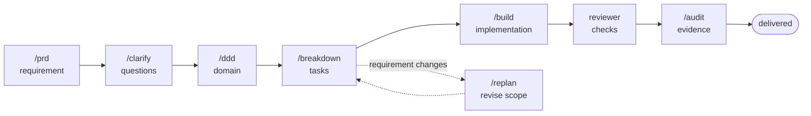

# The Drunken Guild workflow

Drunken Guild takes one piece of work from an agreed requirement to verified delivery. The core
flow works with or without Jira and with or without local CI infrastructure.

## What each step produces

| command or role | purpose | output |
|---|---|---|
| `/prd` | state what is wanted and why | accepted brief and requirements |
| `/clarify` | resolve material ambiguity | decisions and open questions |
| `/ddd` | describe the domain and boundaries | vocabulary and behavior |
| `/breakdown` | turn the requirement into bounded work | tasks and acceptance checks |
| `/build` | implement one approved task | code or documentation change |
| `reviewer` | inspect the proposed change | review findings and approval status |
| `/audit` | compare delivery with acceptance | evidence, gaps and handoff |
| `/replan` | revise an existing plan after a requirement changes | updated scope and tasks |

## The important boundary

Discussion, analysis and a plan do not authorize a file or external-state change. A bounded user
request or an approved task does. Humans decide scope, ordering and merge or release actions;
agents provide the change and evidence.

Local CI is optional. When it exists, record its actual profile, run and revision. When it does
not exist, record `not_run` or `skipped`; never imply that an unavailable check passed.

## Short paths

- A clear, small task may start at `/build`.
- A requirement change after tasks exist goes through `/replan`, then back to `/breakdown`.
- A completed change goes to `/audit` before handoff.
